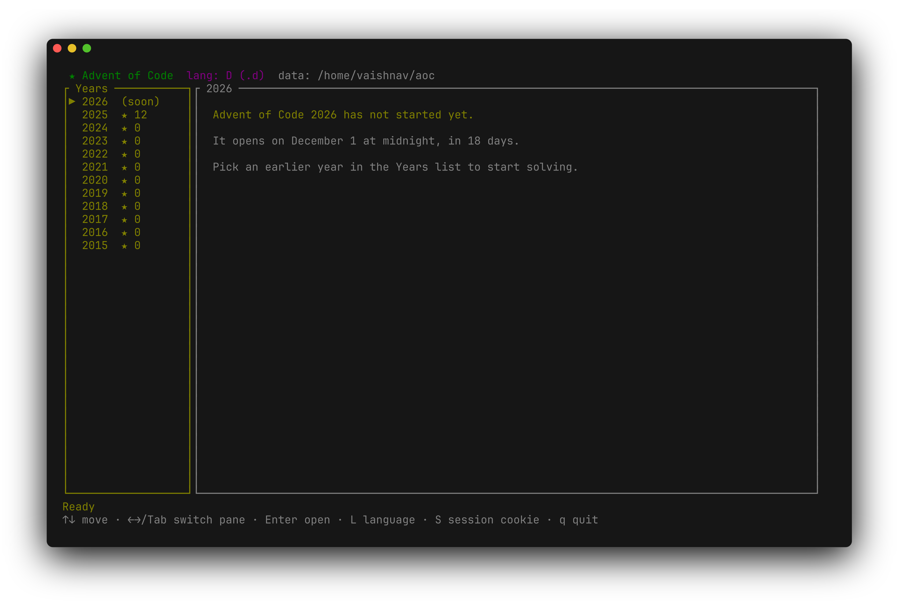

# aoc-tui

A terminal UI for [Advent of Code](https://adventofcode.com).




Browse years/days, view the puzzle text with basic HTML styling, download your personal input, edit a solution in your `$EDITOR`, run it, and submit answers — all from one TUI.

This is a modular Rust rewrite of the original single-file `rust-script`:

<https://codeberg.org/Vaishnav-Sabari-Girish/dotfiles/src/branch/main/zsh/.local/bin/aoc.rs>

## Features

- Year / day picker with star progress
- Puzzle description rendered with colours (headings, code, emphasis, links)
- Personal input download (requires session cookie)
- Edit solution in `$VISUAL` / `$EDITOR` (creates a template if missing)
- Run the solution (stdin = input, stdout = answers)
- Submit part 1 / part 2 answers
- Clipboard support for puzzle / input / output (`y`)
- Multiple language presets (D, C, C++, Rust, Python) + custom
- Config and session stored under `~/aoc` (or `$AOC_DIR`)

## Requirements

- Rust toolchain (`cargo`)
- A terminal that supports the usual TUI features
- Optional clipboard helpers: `wl-copy`, `xclip`, `xsel`, `pbcopy`, or `clip.exe`  
  (falls back to OSC 52)

## Quick start

```bash
git clone https://github.com/craftty-org/aoc-tui
cd aoc-tui
cargo run
```

## Session cookie

Press **S** and paste your Advent of Code session cookie  
(or export `AOC_SESSION`).

It is saved to `~/aoc/.session` (or `$AOC_DIR/.session`).

## Language

Press **L** to choose a preset:

| Language | Extension | Run command                                      |
|----------|-----------|--------------------------------------------------|
| D        | `.d`      | `dub run --single --quiet {file}`                |
| C        | `.c`      | `gcc -O2 -o sol_bin {file} -lm && ./sol_bin`     |
| C++      | `.cpp`    | `g++ -O2 -std=c++20 -o sol_bin {file} && ./sol_bin` |
| Rust     | `.rs`     | `rust-script {file}`                             |
| Python   | `.py`     | `python3 {file}`                                 |
| Others   | custom    | your own command (`{file}` = solution path)      |

Choice is saved in `~/aoc/config`.

## Keybindings

### Picker

| Key        | Action                |
|------------|-----------------------|
| ↑ / k      | Move up               |
| ↓ / j      | Move down             |
| ← / h / Tab| Switch pane           |
| → / l      | Switch pane           |
| Enter      | Open selected day     |
| L          | Language picker       |
| S          | Set session cookie    |
| q / Esc    | Quit                  |

### Day view

| Key          | Action                          |
|--------------|---------------------------------|
| p / i / o    | Puzzle / Input / Output tab     |
| Tab / ← →    | Cycle tabs                      |
| j / k        | Scroll                          |
| Space / PgDn | Page down                       |
| PgUp         | Page up                         |
| g / G        | Top / bottom                    |
| e            | Edit solution (`$EDITOR`)       |
| r            | Run solution                    |
| 1 / 2        | Submit part 1 / part 2          |
| y            | Copy current tab to clipboard   |
| R            | Refresh puzzle + stars          |
| [ / ]        | Previous / next day             |
| L            | Language picker                 |
| S            | Set session cookie              |
| q / Esc      | Back to picker                  |

## Data layout

```
~/aoc/                    # or $AOC_DIR
├── config                # lang / ext / cmd
├── .session              # session cookie
└── 2024/
    └── day01/
        ├── puzzle.html
        ├── input.txt
        └── solution.<ext>
```

## Solution contract

Your program must:

1. Read the puzzle input from **stdin**
2. Print the part 1 answer on the **first line**
3. Print the part 2 answer on the **second line**

Templates for each language already do this.

## Credits

Original single-file `rust-script` implementation:

https://codeberg.org/Vaishnav-Sabari-Girish/dotfiles/src/branch/main/zsh/.local/bin/aoc.rs

This repository is a modular conversion of that script into a proper Cargo binary crate.

(c) 2026, [Vaishnav-Sabari-Girish](https://vaishnavs.is-a.dev/)

Released under the GPL-3.0 license (See [LICENSE](./LICENSE)).
